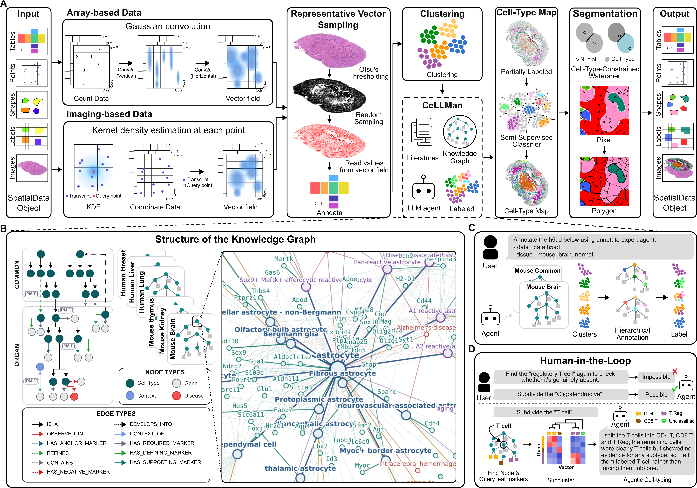

# SSAF-T

**Spatial Segmentation-free Agentic Framework - Transcriptomics**

Assigning cell types from spatial transcriptomics usually depends on cell segmentation, which is
difficult to achieve accurately. SSAF-T removes that dependency: transcripts are turned into a
kernel-density vector field and cell identity is inferred from mRNA signals alone — no segmentation,
no neighborhood aggregation.

The annotation step is agentic and ships as its own repository,
[**CeLLMan**](https://github.com/pnucolab/CeLLMan), linked here as the [`CeLLMan/`](CeLLMan)
submodule: one specialized agent per organism and organ mines PubMed into a knowledge graph of
cell-type marker genes and infers cell identity from the sampled mRNA signals.

<p align="center">
  
</p>

---

## Installation

```bash
git clone --recurse-submodules https://github.com/pnucolab/SSAF-T.git
uv venv .venv --python 3.11
source .venv/bin/activate
```

Then run **one** of the two commands below. 

```bash
# CPU only
uv pip install ./SSAF-T
```

```bash
# same as above, plus GPU acceleration.
uv pip install './SSAF-T[gpu]'
```

Either command builds the C extension, and the default build enables AVX-512 on any x86_64 host
without checking whether the CPU supports it — a machine that lacks it aborts with an illegal
instruction the first time the extension runs. Append `--config-settings=setup-args=-Dsimd=disabled`
to whichever command you chose if either of these applies:

- **x86_64 Linux with no AVX-512** — `lscpu | grep -o avx512f | head -1` prints nothing (most
  consumer Ryzen and Core chips)
- **an Intel Mac** — no Mac has ever shipped with AVX-512

Apple Silicon and other ARM hosts need nothing extra: SIMD is not enabled there to begin with.

The package is imported as `ssaft`:

```python
import ssaft
```

Then register the annotation skill and the expert agent with your LLM host. Both live in the
`CeLLMan/` submodule — if you cloned without `--recurse-submodules`, run
`git submodule update --init` first.

```bash
# claude code
mkdir -p .claude/skills .claude/agents
cp -r SSAF-T/CeLLMan/skills/annotate-mode .claude/skills/
cp SSAF-T/CeLLMan/agents/annotate-expert.md .claude/agents/
```

```bash
# codex
mkdir -p .agents/skills .codex/agents
cp -r SSAF-T/CeLLMan/skills/annotate-mode .agents/skills/
cp SSAF-T/CeLLMan/agents/annotate-expert.toml .codex/agents/
printf '\n[sandbox_workspace_write]\nnetwork_access = true\n' >> .codex/config.toml
```

---

## Documentation

The documentation lives in [`docs/`](docs) and is built with Sphinx (see
[`.readthedocs.yaml`](.readthedocs.yaml)). It takes the pipeline one stage at a time under
[`docs/pipeline/`](docs/pipeline) and gives one worked example per data modality:

| tutorial | modality | map |
|---|---|---|
| [`docs/tutorials/array.md`](docs/tutorials/array.md) | array-based spatial transcriptomics (Visium HD, mouse small intestine) | 2D |
| [`docs/tutorials/imaging.md`](docs/tutorials/imaging.md) | imaging-based spatial transcriptomics (Xenium, mouse kidney) | 3D |

The notebook each one is written from is under [`docs/notebooks/`](docs/notebooks). It begins with
the commands that download its public dataset, so the example can be run start to finish.

[`notebooks/`](notebooks) is something else: the scripts that reproduce the figure panels of the
paper, one directory per dataset. Each holds a `run_ssaft.py` for the run itself and numbered
scripts for the panels that dataset contributes, reading nothing but the SSAF-T output and the
files the original authors published.

For how to phrase the prompt that starts an annotation run, see
[`CeLLMan/CALLER_PROMPT_GUIDE.md`](CeLLMan/CALLER_PROMPT_GUIDE.md).

---

## License

BSD 3-Clause. See [LICENSE](LICENSE).
